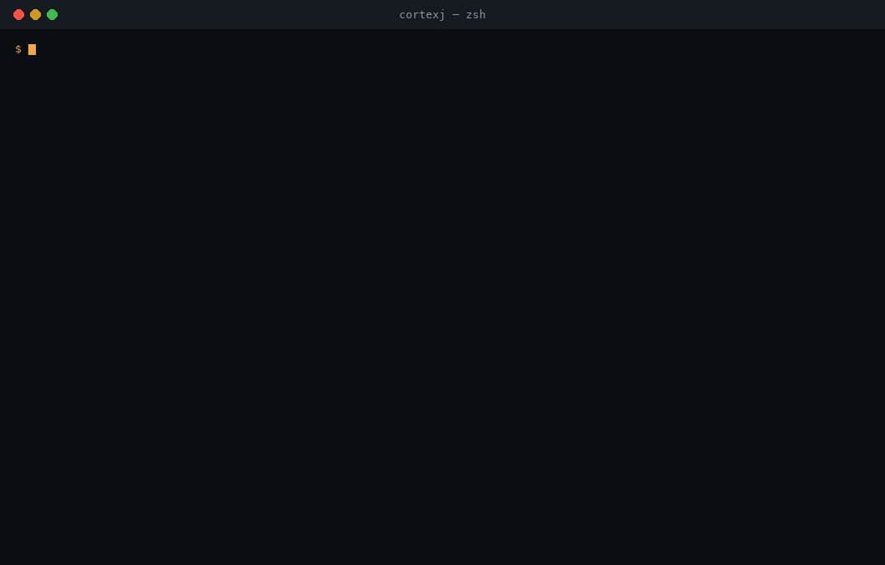

# CortexJ

**CortexJ Runtime — portable AI execution for the JVM.**

One JVM API. Compatible models. The best available runtime. Production AI from
Java 8 to Java 25+, without mandatory Python. From legacy Java 8 applications
to modern Java 25 systems, across interchangeable local and remote runtimes.

> Long-term direction: **CortexJ — the AI development
> platform for the JVM, from experimentation to production.** The Runtime
> below is its first production product and stays standalone: no Lab, Data,
> Train or research dependencies ever leak into the production path.

```java
CortexJ platform = CortexJ.builder().build();

try (ModelHandle model = platform.models().load(ModelReference.of("Qwen/Qwen3-8B"))) {
    GenerationResponse response = model
            .capability(TextGenerationCapability.class)
            .generate(GenerationRequest.prompt("Explain CQRS"));
    System.out.println(response.text());
}
```

The platform answers the infrastructure questions itself: where the model lives, which
revision to use, which artifacts are compatible, which runtimes are installed, what hardware
is available, whether memory suffices, what the fallback is — and *why* the chosen
execution path was selected.



> **Status: 1.0.0-RC1.** Feature-complete for the runtime track; artifacts are published
> to the [CortexJ Maven repository](https://okostiukevych.github.io/CortexJ-maven/) and to
> [JitPack](https://jitpack.io/#okostiukevych/CortexJ). Maven Central publication is still
> ahead (namespace verification), GPU CI lanes need self-hosted runners, and the
> dependency set below matches the versions CI runs against. Limitations are stated in the
> [docs](https://okostiukevych.github.io/CortexJ-site/), not hidden.

## Quick start

**60 seconds, nothing to download.** The CLI reports what it *would* do on your
machine — runtime probes, hard constraints, memory headroom, the reasons and the
fallback chain — before a single byte is fetched:

```bash
# one jar, any JVM 8 → 25
curl -L -o cortexj.jar https://okostiukevych.github.io/CortexJ-maven/io/cortexj/cortexj-cli/1.0.0-RC1/cortexj-cli-1.0.0-RC1.jar

java -jar cortexj.jar doctor               # environment, runtimes, recommendations
java -jar cortexj.jar plan Qwen/Qwen3-8B-GGUF   # the explainable plan (shown above)
java -jar cortexj.jar pull Qwen/Qwen3-8B-GGUF   # download exactly the planned artifact
java -jar cortexj.jar run Qwen/Qwen3-8B-GGUF --prompt "Explain CQRS in one sentence"
```

### From your build

Artifacts are published to the CortexJ Maven repository. Until the platform
reaches Maven Central, declare the repository once in your `pom.xml`:

```xml
<repositories>
    <repository>
        <id>cortexj</id>
        <url>https://okostiukevych.github.io/CortexJ-maven/</url>
    </repository>
</repositories>

<dependencyManagement>
    <dependencies>
        <dependency>
            <groupId>io.cortexj</groupId>
            <artifactId>cortexj-bom</artifactId>
            <version>1.0.0-RC1</version>
            <type>pom</type>
            <scope>import</scope>
        </dependency>
    </dependencies>
</dependencyManagement>

<dependency>
    <groupId>io.cortexj</groupId>
    <artifactId>cortexj-starter-java21</artifactId>
</dependency>
```

<details>
<summary>JitPack instead of the CortexJ repository</summary>

The same tag is built by JitPack under its own group id. There the BOM does
not apply (JitPack rewrites each module's coordinates but not the BOM's
managed entries), so name the version explicitly:

```xml
<repository>
    <id>jitpack.io</id>
    <url>https://jitpack.io</url>
</repository>

<dependency>
    <groupId>com.github.okostiukevych.CortexJ</groupId>
    <artifactId>cortexj-starter-java21</artifactId>
    <version>1.0.0-RC1</version>
</dependency>
```

</details>

Starters for **every supported LTS line**: `cortexj-starter-java8`,
`cortexj-starter-java11`, `cortexj-starter-java17`, `cortexj-starter-java21`,
`cortexj-starter-java25`. The starter matches your JVM at bootstrap: using a starter
built for a newer JVM fails fast with an actionable diagnostic, and the
business code stays identical across all five.

### Spring Boot auto-configuration

`cortexj-spring-boot-starter` (Spring Boot 4.x, Java 17+) wires the platform and an
auto-loaded `ChatModel` from `cortexj.*` properties; see the [Spring AI guide](https://okostiukevych.github.io/CortexJ-site/docs/integrations/)
and the [tool-calling guide](https://okostiukevych.github.io/CortexJ-site/docs/tool-calling/) for tool-loop usage:

```yaml
cortexj:
  model: qwen3/qwen3-4b
  offline: false
  allow-remote-runtime: true
  remote:
    base-url: https://my-openai-compatible-endpoint/v1
    api-key: sk-...
```

```java
@Service
class AnswerService {
    private final ChatModel model;   // CortexJChatModel auto-wired
    AnswerService(ChatModel model) { this.model = model; }
}
```

Every bean is overridable (`@ConditionalOnMissingBean`); an unresolvable `cortexj.model`
fails the startup with a typed `CORTEXJ-` diagnostic.

## CLI

```text
java -jar cli/target/cortexj-cli-*.jar doctor
java -jar cli/target/cortexj-cli-*.jar runtimes
java -jar cli/target/cortexj-cli-*.jar hardware
java -jar cli/target/cortexj-cli-*.jar inspect Qwen/Qwen3-8B
java -jar cli/target/cortexj-cli-*.jar plan Qwen/Qwen3-8B --offline
java -jar cli/target/cortexj-cli-*.jar plan Qwen/Qwen3-8B --runtime llamacpp
java -jar cli/target/cortexj-cli-*.jar pull Qwen/Qwen3-8B
java -jar cli/target/cortexj-cli-*.jar run Qwen/Qwen3-8B --prompt "Explain MVCC"

# reproducible deployments
java -jar cli/target/cortexj-cli-*.jar plan Qwen/Qwen3-8B --lockfile-out release.lock
java -jar cli/target/cortexj-cli-*.jar run Qwen/Qwen3-8B --lockfile release.lock

# air-gap bundles
java -jar cli/target/cortexj-cli-*.jar bundle create Qwen/Qwen3-8B --out ./bundle
java -jar cli/target/cortexj-cli-*.jar bundle verify ./bundle

# cache management
java -jar cli/target/cortexj-cli-*.jar cache list
java -jar cli/target/cortexj-cli-*.jar cache clean
```

Guides for every supported runtime, adapter and extension point live on the
[project site](https://okostiukevych.github.io/CortexJ-site/).

## Architecture

```text
            Direct CortexJ API          Spring AI / LangChain4j / OpenTelemetry adapters
                    │
                 CORTEXJ
   Model Resolver │ Capability/Hardware │ Diagnostics
                    │
             EXECUTION PLANNER
  Candidates │ Policies │ Memory Model │ Explanation
                    │
              Runtime SPI (ServiceLoader)
    ONNX │ llama.cpp │ OpenAI-remote │ future X
                    │
              CPU / GPU / NPU
```

Layering rules (enforced by module boundaries):

- `cortexj-api` — shared public contract + SPI packages (`io.cortexj.spi.*`), Java 8 bytecode baseline.
  No framework and no engine dependencies (AP-001, AP-002).
- `cortexj-core` — bootstrap, registries, download manager, lifecycle, fallback. Never depends on a
  concrete runtime (AC-RUNTIME-001).
- Runtimes are plugins discovered via `ServiceLoader`; planner decisions are driven by descriptors
  and policies, never by provider order (deterministic scoring + tie-breaks).
- LTS-specific behavior lives in `cortexj-platform-java{8,11,17,21,25}` behind the
  `PlatformModule` SPI (virtual threads from Java 21+).

## Modules

| Module | Purpose |
|---|---|
| `cortexj-api` | Public API, planner types, streaming, diagnostics, errors, SPI contracts |
| `cortexj-spi` | Provider developer kit (contexts, support classes) |
| `cortexj-model` | Artifact inspection: real GGUF binary parser, safetensors header, ONNX probe |
| `cortexj-hardware` | Environment/hardware discovery (safe probes, no shell-outs) |
| `cortexj-cache` | Checksum-safe cache, atomic writes, LRU eviction, path-traversal hardening |
| `cortexj-planner` | Execution planner: hard constraints, scoring policies, memory estimation, explanations |
| `cortexj-core` | Platform bootstrap, ServiceLoader registries, download manager, lifecycle, fallback |
| `cortexj-streaming` | `TokenStream` implementation utilities |
| `cortexj-repository-local` | Local filesystem repository (`cortexj-model.json` manifests) |
| `cortexj-repository-huggingface` | Hugging Face resolver (immutable revisions, offline mode) |
| `cortexj-repository-http` | Plain HTTP(S) URL references (ETag revisions, trust notes) |
| `cortexj-runtime-remote-openai` | OpenAI-compatible remote provider (vLLM, llama-server, gateways) |
| `cortexj-runtime-onnx` | ONNX Runtime provider (probe, session load, Hf tokenizer, embeddings) |
| `cortexj-runtime-llamacpp` | llama.cpp provider: probe, **managed llama-server process bridge** (blocking + SSE execution), honest diagnostics |
| `cortexj-runtime-djl` | DJL provider (honest engine probe, ONNX embeddings when engine artifacts are added) |
| `cortexj-runtime-isolated` | Isolated native worker mode: child-JVM runtime host for crash isolation, opt-in per runtime |
| `cortexj-worker` | Worker host main: NDJSON stdio protocol bridging a RuntimeProvider inside a child JVM |
| `cortexj-observability` | OpenTelemetry adapter: platform events to OTel counters/histograms/spans |
| `cortexj-streaming-flow` | Java `Flow.Publisher` streaming adapter (Java 11+) |
| `cortexj-convert-gguf` | Deterministic GGUF F32↔F16 converter (Level C, provenance manifests) |
| `cortexj-convert-safetensors` | Deterministic Safetensors→GGUF re-containerization (config.json metadata, Level C) |
| `cortexj-declarative` | Declarative interface API: `@ModelPrompt` + dynamic proxy, `JsonPromptDecoder` |
| `cortexj-server` | Optional OpenAI-compatible embedded server |
| `cortexj-maven-plugin` | `cortexj:verify` build-time deployment verification |
| `cortexj-examples` | Compilable examples: Java 8 legacy app, plan-before-execution, explicit ONNX, third-party runtime plugin |
| `cortexj-examples-spring-ai` | Spring AI bean wiring example (Java 17+) |
| `integrations/spring-ai` | Spring AI 2.0.x adapter: `ChatModel` (call + stream + tool loop), `StreamingChatModel`, `EmbeddingModel`, full message/options/usage mapping (Java 17+) |
| `starters/spring-boot` | Spring Boot 4.x auto-configuration: `cortexj.*` properties -> platform + `ChatModel` beans, user-overridable (Java 17+) |
| `integrations/langchain4j` | LangChain4j adapter: `ChatModel`, `StreamingChatModel`, `EmbeddingModel` (Java 17+) |
| `cortexj-platform-java8..25` | LTS platform modules |
| `cortexj-starter-java8/11/17/21/25` | Maven starters with JVM validation |
| `cortexj-tck` | Technology compatibility kit for runtime/repository providers |
| `cortexj-cli` | `doctor / runtimes / hardware / inspect / plan / pull / run / server / convert / cache list,clean / bundle create,verify` |

## Status

CortexJ **1.0.0-RC1** is feature-complete for the runtime track: model
resolution, planning, execution, caching, conversion, observability and the
integration adapters are implemented and tested. The remaining step is the
Maven Central publication itself; coordinates, licensing, packaging and the
release pipeline are ready. Release notes:
[1.0.0-RC1](https://github.com/okostiukevych/CortexJ/releases/tag/1.0.0-RC1) ·
artifacts in the [CortexJ Maven repository](https://okostiukevych.github.io/CortexJ-maven/)
and on [JitPack](https://jitpack.io/#okostiukevych/CortexJ).

**Delivered**

- Model resolution: local filesystem and Hugging Face repositories, immutable
  revisions, checksum-verified cache, offline mode, air-gap bundles.
- Execution planner: deterministic candidates, hard constraints, explainable
  scoring, memory estimates, benchmark hints and enterprise runtime policy.
- Runtimes: ONNX Runtime (probe/load/tokenizer/embeddings), llama.cpp with a
  managed `llama-server` process bridge (blocking + SSE streaming), DJL
  (honest engine probe), OpenAI-compatible remote endpoints, and an isolated
  child-JVM native worker for crash containment.
- Production surface: lockfiles, conversion subsystem (GGUF F32/F16,
  Safetensors to GGUF), OpenTelemetry adapter, embedded OpenAI-compatible
  server, Maven plugin, CLI, Spring AI 2.0.x and LangChain4j 1.22.x adapters,
  and a Spring Boot 4.x starter.
- Five LTS platform modules (Java 8/11/17/21/25) with wrong-JVM detection and
  an identical API surface across all of them.

**Verification**

- Real-JDK test matrix: JDK 8 (1154 tests), 11 (1184), 17 (1520), 21 (1634),
  25 (1712) - all green. Gated native-runtime skips are loud `assumeTrue`
  assertions, never silent passes.
- JDK 25 additionally runs SpotBugs (`mvn verify -Pspotbugs`) with zero
  findings outside the documented excludes.
- Perf-tagged suites (load, throughput, contention, wide-matrix planning) run
  separately with `mvn test -Pperf`.
- GitHub Actions: JDK 8/11/17/21/25 on Linux and macOS, Windows smoke lanes,
  JPMS lanes, SpotBugs + JaCoCo, and CodeQL. GPU lanes are opt-in on
  self-hosted CUDA/Metal runners.
- The `compat` profile is ready for japicmp gating once the first public
  release exists as a baseline.

**Known limitations**

- llama.cpp and the embedded server currently report tool-call finish reasons
  without executing the tool loop; the OpenAI-compatible remote runtime and
  the Spring AI adapter provide the full tool-calling contract.
- Tool-call streaming through the llama.cpp bridge is partial.
- DJL engine artifacts and the optional JInfer runtime are not bundled;
  providers report their absence honestly.
- GPU execution paths require hardware that is not available on hosted CI.

## Build

The reactor adapts to the building JDK via profiles:

| Build JDK | Modules built |
|---|---|
| 8 | shared core, platform-java8, starter-java8, providers, TCK |
| 11 | + platform-java11, starter-java11 |
| 17 | + platform-java17, starter-java17 |
| 21 | + platform-java21, starter-java21 |
| 25 | + platform-java25, starter-java25, CLI (fat jar) |

```text
mvn clean install
```

Multi-JDK verification (executed on real JDKs 8/11/17/21/25):

- `mvn test` green on each LTS JDK — the full reactor suite per lane (1154 tests on
  the JDK 8 lane, 1184 on JDK 11, 1520 on JDK 17, 1634 on JDK 21, 1712 on JDK 25),
  0 failures on every lane (re-verified locally on real JDKs 8/11/17/21/25,
  audit 2026-10-21)
  (JDK 8 build uses `-source/-target 8`; JDK 9+ uses `--release 8`).
- The single shaded CLI jar runs unchanged on Java 8 through 25, reporting the correct
  JVM each time; newer platform classes are skipped gracefully on older JVMs, and the
  matching `PlatformModule` is selected at runtime (fixed pool on 8–17, virtual threads
  from 21+).
- `cortexj-starter-java25` on a Java 8 JVM fails fast with `CORTEXJ-CONF-0002`
  and the exact remediation: *replace with cortexj-starter-java8*.

~1712 automated tests across ~270 test classes: planner synthetic matrices (determinism, hard
constraints, JVM/quality/offline policies, benchmark hints, enterprise policy rules), provider
TCK (lifecycle, streaming, cancellation, registration, conversion, platform, policy contracts), concurrency/race regression
suite (double-close, cold-load races, close-during-stream, cancellation - tagged `concurrency`),
download integrity + retry matrix, cache safety + amortized eviction, resource-leak assertions
(process exit, executor termination, temp cleanup, handle closure), isolated-worker child-JVM
round-trips (crash, streaming, leaks), SSRF/secret/parser hardening suites, and end-to-end load→plan→execute→close cycles.
Perf-tagged suites (server load, wide-matrix planning, parser fuzz, cache contention, conversion
throughput) run separately with `mvn test -Pperf`.

## Configuration priority

programmatic builder > system properties (`cortexj.*`) > environment variables
(`CORTEXJ_*`). Offline mode: `cortexj.offline=true` / `CORTEXJ_OFFLINE=1`. Remote runtime:
`CORTEXJ_REMOTE_BASE_URL` (+ `CORTEXJ_REMOTE_API_KEY`). Hugging Face token:
`CORTEXJ_HF_TOKEN` (never logged).
